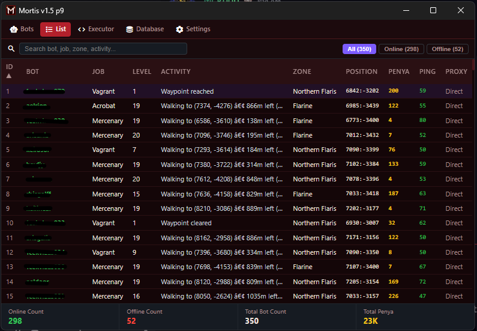

# Echoes of Madrigal - Multibot

<p align="left">
  <a href="https://discord.gg/jxDdPXSUWw"></a>
  
  
  
  
  <a href="LICENSE"></a>
</p>

A simple desktop multi-client manager and automation tool built with Go, Wails, and React.

---

<p align="center">
  
</p>

---

## What it does

- **Multi-bot management:** Run and manage multiple accounts in one window.
- **Auto-farm:** Basic combat loop, mob targeting, skill casting, and area roaming.
- **Party support:** Auto invite/accept, leader follow, and party skill upkeep.
- **Inventory handling:** Simple auto-sell and item management.
- **Radar / Map:** Real-time character coordinates and nearby entities.

## Requirements

- [Go](https://go.dev/) 1.22+
- [Node.js](https://nodejs.org/) 18+
- [Wails v2](https://wails.io/) (`go install github.com/wailsapp/wails/v2/cmd/wails@latest`)

## Getting Started

1. Clone and enter directory:
   ```bash
   git clone https://github.com/dotjoma/MortisX_EOM.git
   cd MortisX_EOM
   ```

2. Copy example config and add your account details:
   ```bash
   cp bot.example.json bot.json
   ```

3. Install frontend dependencies:
   ```bash
   npm install
   ```

4. Run in dev mode:
   ```bash
   wails dev
   ```

To build a standalone `.exe`:
```bash
wails build
```
Output will be in `build/bin/`.

## Community

Join the discussion or report issues on Discord:
👉 **[Join Discord](https://discord.gg/jxDdPXSUWw)**

## License

[MIT](LICENSE)

## Note

Personal hobby project made for testing and educational use.
